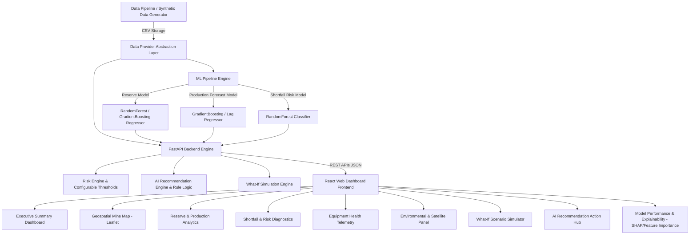

# Implementation Plan — MineAI Sentinel
**AI-Powered Manganese Reserve Intelligence & Production Risk Platform**

MineAI Sentinel is an enterprise-grade AI decision-support platform designed for **MOIL Limited** manganese mining operations. It combines geological data, historical production records, telemetry from mining machinery, satellite environmental telemetry (rainfall, soil moisture, NDVI, land surface temperature), and operational constraints (blasting delays, maintenance backlogs) into a unified predictive risk engine and real-time interactive decision support dashboard.

---

## User Review Required

> [!IMPORTANT]
> **Data Disclosure & Synthetic Demo Mode**:
> In accordance with hackathon guidelines, the system operates on a realistic, multi-variable synthetic dataset modeling manganese ore bodies (e.g. Balaghat / Ukwa mine formations). All UI elements display a **"Demo Mode — Synthetic Dataset"** badge, while maintaining a clean `DataProvider` abstraction pattern (`SyntheticDataProvider` vs `RealDataProvider`) allowing seamless plug-and-play replacement when real MOIL datasets are provided.

> [!NOTE]
> **Architecture Overview**:
> - **Backend**: Python 3.13, FastAPI, Scikit-Learn, Pandas, NumPy, Joblib, Pydantic v2.
> - **Frontend**: React (Vite, JS/JSX), Tailwind CSS, Recharts, Leaflet / React-Leaflet, Lucide Icons.
> - **Data & ML**: Reusable ML pipelines for Reserve Estimation (Regressor), Production Forecasting (Time-series Regressor with lag features), and Shortfall Risk (Classifier).
> - **Deployment & DevOps**: Docker, Docker Compose, CORS configured, environment variables (`VITE_API_URL`).

---

## Proposed System Architecture



---

## Data Schema & Data Dictionary

The platform utilizes 5 inter-linked synthetic datasets generated with physical relationships and realistic noise:

1. `block_data.csv` / `geological_data.csv`:
   - `block_id` (str): Mine block identifier (e.g., `BLK-B01`).
   - `block_name` (str): Descriptive section name (e.g., `Balaghat North Vein`).
   - `latitude` (float), `longitude` (float), `elevation_m` (float).
   - `depth_m` (float): Average drilling/reserve depth (50m–350m).
   - `rock_density_gt_m3` (float): Ore rock density (2.8–4.2 g/cm³).
   - `drill_hole_density` (int): Number of exploration core drills per hectare.
   - `est_mn_grade_pct` (float): Estimated manganese grade (25.0%–48.0% Mn).
   - `soil_moisture_pct` (float): Satellite soil moisture index (10%–85%).
   - `ndvi_index` (float): Vegetation index (0.1–0.75).
   - `lst_temp_c` (float): Land surface temperature (18°C–44°C).
   - `annual_rainfall_mm` (float): Local rainfall indicator (800mm–2400mm).
   - `est_tonnage_mt` (float): Target prediction feature (Total estimated ore in Thousand Metric Tonnes).
   - `recoverable_tonnage_mt` (float): Target prediction feature (Recoverable ore considering mining loss factors).

2. `production_data.csv`:
   - `date` (date): Daily record timestamp.
   - `block_id` (str): Associated mine block.
   - `target_production_tonnes` (float): Planned target production per day (800–2500 tonnes).
   - `actual_production_tonnes` (float): Target prediction feature (Actual ore mined per day).
   - `operating_hours` (float): Daily active shift duration (12.0–24.0 hours).
   - `active_machines_count` (int): Count of active heavy equipment on site (4–15).
   - `blasting_delay_hours` (float): Delays due to explosive permits, weather, or safety clearing (0.0–6.0 hrs).
   - `maintenance_delay_hours` (float): Equipment breakdown downtime (0.0–8.0 hrs).
   - `rainfall_mm` (float): Daily rainfall recorded (0.0–120.0 mm).
   - `temperature_c` (float): Ambient surface temperature.
   - `avg_mn_grade_mined` (float): Mined ore grade %.

3. `equipment_data.csv`:
   - `equipment_id` (str): Asset ID (e.g., `EQ-CAT-777D-01`, `EQ-KOM-PC1250-04`).
   - `equipment_type` (str): Haul Truck, Hydraulic Excavator, Blast Hole Drill, Wheel Loader.
   - `block_id` (str): Currently assigned mine block.
   - `operating_hours_total` (float): Cumulative operating hours.
   - `maintenance_hours_month` (float): Scheduled/unscheduled maintenance hours.
   - `downtime_hours_month` (float): Breakdown downtime hours.
   - `breakdown_frequency` (int): Count of breakdown incidents in the last 30 days.
   - `fuel_efficiency_lph` (float): Liters of diesel consumed per hour.
   - `availability_pct` (float): Asset operational availability percentage.
   - `downtime_risk` (str): Calculated risk category (`LOW`, `MEDIUM`, `HIGH`).
   - `production_contribution_tpd` (float): Daily tonnage moved by asset.

4. `environmental_data.csv`:
   - `date` (date): Daily satellite telemetry record.
   - `block_id` (str): Mine location block.
   - `rainfall_mm` (float): Pre-blasting precipitation depth.
   - `soil_moisture_pct` (float): Satellite moisture ratio impacting haul-road stability.
   - `ndvi` (float): Vegetation density surrounding pit edges.
   - `land_surface_temp_c` (float): Thermal monitoring for thermal stress / dust mitigation.
   - `haul_road_condition` (str): `EXCELLENT`, `MODERATE`, `SLIPPERY`, `HAZARDOUS`.
   - `environmental_risk_score` (float): 0–100 calculated score.

---

## Machine Learning Models & Evaluation Strategy

1. **Reserve Estimation Model**:
   - **Task**: Multi-output regression (Predict Ore Tonnage `MT` and Mn Grade `%`).
   - **Algorithms**: `RandomForestRegressor` vs `GradientBoostingRegressor`.
   - **Features**: `depth_m`, `rock_density_gt_m3`, `drill_hole_density`, `elevation_m`, `soil_moisture_pct`, `ndvi_index`, `lst_temp_c`, `annual_rainfall_mm`.
   - **Metrics**: MAE, RMSE, R².

2. **Production Forecasting Model**:
   - **Task**: Time-series production regressor (Predict Next-Day, Next-Week, Next-Month production).
   - **Algorithms**: `GradientBoostingRegressor` / `RandomForestRegressor` with engineered lag features (`lag_1d`, `lag_7d`, `rolling_7d_mean`, `lag_30d_mean`).
   - **Features**: Lag features, `operating_hours`, `active_machines_count`, `blasting_delay_hours`, `maintenance_delay_hours`, `rainfall_mm`, `target_production_tonnes`, `avg_mn_grade_mined`.
   - **Metrics**: MAE, RMSE, R².

3. **Shortfall Prediction & Classification Model**:
   - **Task**: Multi-class risk classifier (`LOW`, `MEDIUM`, `HIGH`) & Shortfall Probability (`0%–100%`).
   - **Algorithms**: `RandomForestClassifier` vs `HistGradientBoostingClassifier`.
   - **Features**: Ratio of target to historical baseline, total downtime hours, rainfall, soil moisture, blasting delays, active machinery ratio.
   - **Metrics**: Accuracy, Precision, Recall, F1 Score, ROC-AUC.
   - **Explainability**: SHAP value calculation / Feature importance extraction for root cause analysis.

---

## FastAPI REST Endpoints Specification

| Method | Path | Description |
| :--- | :--- | :--- |
| `GET` | `/api/health` | Healthcheck endpoint with engine status |
| `GET` | `/api/dashboard/summary` | Combined Executive KPI cards, production trends, top risks |
| `GET` | `/api/reserves` | Complete geological block reserves list |
| `GET` | `/api/reserves/map` | GeoJSON / Feature collection for map visualization |
| `POST` | `/api/reserves/predict` | Predict reserve tonnage & grade for new drillhole inputs |
| `GET` | `/api/production/history` | Historical production trends |
| `GET` | `/api/production/forecast` | Next-day, 7-day, 30-day production forecast |
| `POST` | `/api/production/forecast` | Custom feature forecasting query |
| `POST` | `/api/shortfall/predict` | Predict shortfall risk probability and contributing factors |
| `GET` | `/api/equipment` | Equipment fleet inventory & status |
| `GET` | `/api/equipment/risks` | Equipment breakdown risk analytics |
| `GET` | `/api/environment` | Environmental & satellite indicators |
| `GET` | `/api/risks` | Combined operational risk score & factor breakdown |
| `GET` | `/api/recommendations` | Dynamically generated corrective actions |
| `POST` | `/api/what-if` | Interactive what-if simulator endpoint |
| `GET` | `/api/model/metrics` | Train metrics, test metrics, feature importances |

---

## Frontend Layout & Navigation Pages

The React application uses a modern dark/industrial glassmorphism aesthetic with high contrast data visibility:

1. **Header**: Title "MineAI Sentinel", Subtitle "AI-Powered Manganese Reserve Intelligence", Demo Mode Badge, Quick Refresh button.
2. **Navigation Sidebar**:
   - 📊 Executive Dashboard
   - 🗺️ Mine Reserve Map
   - ⛏️ Reserve Intelligence
   - 📈 Production Forecast
   - ⚠️ Shortfall Risk
   - 🚜 Equipment Health
   - 🛰️ Satellite & Environment
   - 🎛️ What-If Simulator
   - 💡 AI Recommendations
   - 🧠 Model Performance & Explainability

---

## Proposed Directory Structure

```
mineai-sentinel/
├── backend/
│   ├── app/
│   │   ├── api/
│   │   │   ├── endpoints.py
│   │   │   └── router.py
│   │   ├── core/
│   │   │   ├── config.py
│   │   │   └── data_provider.py
│   │   ├── models/
│   │   │   └── pydantic_schemas.py
│   │   ├── services/
│   │   │   ├── recommendation_engine.py
│   │   │   ├── risk_engine.py
│   │   │   └── simulator.py
│   │   └── main.py
│   ├── ml/
│   │   ├── generator.py
│   │   ├── train.py
│   │   ├── predictor.py
│   │   └── saved_models/
│   │       ├── reserve_model.joblib
│   │       ├── production_model.joblib
│   │       └── shortfall_model.joblib
│   ├── tests/
│   │   └── test_api.py
│   └── requirements.txt
├── frontend/
│   ├── public/
│   ├── src/
│   │   ├── components/
│   │   │   ├── ExecutiveDashboard.jsx
│   │   │   ├── MineMap.jsx
│   │   │   ├── ReserveIntelligence.jsx
│   │   │   ├── ProductionForecast.jsx
│   │   │   ├── ShortfallRisk.jsx
│   │   │   ├── EquipmentHealth.jsx
│   │   │   ├── SatelliteEnvironment.jsx
│   │   │   ├── WhatIfSimulator.jsx
│   │   │   ├── AiRecommendations.jsx
│   │   │   ├── ModelPerformance.jsx
│   │   │   ├── Navbar.jsx
│   │   │   └── Sidebar.jsx
│   │   ├── App.jsx
│   │   ├── index.css
│   │   └── main.jsx
│   ├── package.json
│   ├── vite.config.js
│   └── tailwind.config.js
├── data/
│   ├── raw/
│   ├── processed/
│   └── README.md
├── docs/
│   ├── architecture.md
│   ├── data_dictionary.md
│   ├── ml_pipeline.md
│   └── deployment.md
├── docker-compose.yml
├── Dockerfile
├── .env.example
├── .gitignore
├── LICENSE
└── README.md
```

---

## Step-by-Step Implementation Strategy

1. **Phase 1: Foundation & Data Generation**
   - Setup project structure, create Python environment configuration.
   - Implement `backend/ml/generator.py` to create high-quality, realistic synthetic datasets with physical correlation and noise.
   - Save datasets under `data/raw/` and create comprehensive `docs/data_dictionary.md`.

2. **Phase 2: ML Model Training & Pipeline**
   - Build modular training scripts in `backend/ml/train.py`.
   - Train Reserve Estimation Model (Random Forest / Gradient Boosting Regressor).
   - Train Production Forecast Model with lag features.
   - Train Shortfall Risk Classification Model (Random Forest Classifier).
   - Calculate metrics (MAE, RMSE, R², Accuracy, Precision, Recall, F1, ROC-AUC) and feature importances.
   - Save artifacts in `backend/ml/saved_models/`.

3. **Phase 3: Core Domain Services & FastAPI Backend**
   - Implement `DataProvider` interface & `SyntheticDataProvider`.
   - Build `RiskEngine`, `RecommendationEngine`, `SimulatorService`.
   - Build FastAPI endpoints with Pydantic request/response schemas.
   - Write pytest unit test suite in `backend/tests/`.

4. **Phase 4: Modern React Frontend Dashboard**
   - Scaffold Vite React app with Tailwind CSS and Lucide React icons.
   - Integrate Leaflet & React-Leaflet for interactive geospatial mine block rendering.
   - Integrate Recharts for production trends, forecast charts, equipment availability bars, risk breakdowns.
   - Build all 10 interactive modules (Executive Dashboard, Mine Map, Reserves, Forecast, Shortfall, Equipment, Environment, What-If Simulator, Recommendations, Model Metrics).

5. **Phase 5: DevOps, Docker & Documentation**
   - Write `Dockerfile` and `docker-compose.yml`.
   - Write detailed `README.md` with system architecture diagrams, judge flow, API guide, and quick start instructions.
   - Add `.gitignore`, `.env.example`, `LICENSE`, `docs/architecture.md`, `docs/deployment.md`.

---

## Verification & Testing Plan

### Automated Testing
- `pytest backend/tests/`: Validates data generator, ML predictors, risk calculation, recommendation logic, and FastAPI response status codes.
- `npm run build` in `frontend/`: Validates JS/JSX compilation, React components, and asset bundler without errors.

### Manual & Interactive Judge Demonstration Walkthrough
1. **Dashboard Check**: Verify KPI metrics, production gap alerts, environmental risk index.
2. **Mine Map**: Click mine blocks (e.g. `Balaghat Vein B01`), verify popup showing predicted reserves, Mn grade %, risk tier, and production priority.
3. **Shortfall & Explainability**: Inspect shortfall risk probability (e.g. 74%) and verify top contributing factors (Equipment Downtime +24, Rainfall +18).
4. **AI Recommendation Hub**: Check rule-driven operational suggestions (e.g. equipment reallocation from low-priority to high-priority blocks).
5. **What-If Simulator**: Adjust equipment availability slider from 60% to 90%, observe live recalculation of production forecast and shortfall risk downgrade from HIGH to LOW.
6. **Model Performance**: Verify transparent evaluation tables and feature importance charts.
