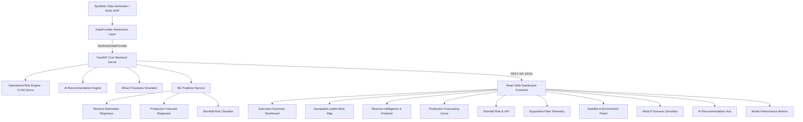

# MineAI Sentinel ⚡ — Complete Project Overview

> **AI-Powered Manganese Reserve Intelligence & Production Risk Platform**  
> *Developed for MOIL Limited Problem Statement | Smart India Hackathon (SIH 2026)*

---

## 📌 Executive Summary

**MineAI Sentinel** is an enterprise-grade AI decision-support platform engineered specifically for **MOIL Limited** (India's largest producer of manganese ore). 

The platform addresses a critical challenge in underground and open-cast manganese mining: **eliminating the mismatch between estimated ore reserves, planned production targets, and actual daily output**. By unifying geological borehole data, heavy equipment telemetry, satellite environmental indicators, and operational constraints into an integrated Machine Learning pipeline, MineAI Sentinel empowers mining engineers and executive leadership to predict reserve tonnages, forecast shortfalls up to 30 days in advance, simulate operational scenarios, and receive AI-driven corrective action recommendations in real time.

---

## 🏛️ Key System Architecture

MineAI Sentinel adopts a modular, decoupled micro-architecture:



### Core Architecture Layers:
1. **Data Layer (`DataProvider` Pattern)**: Decoupled interface allowing effortless switching between local synthetic CSV datasets (`SyntheticDataProvider`) and enterprise SQL/ERP databases (`RealDataProvider`) without altering backend logic or frontend code.
2. **Backend API (`FastAPI` + `Pydantic v2`)**: Asynchronous Python REST API providing real-time inference, risk evaluation, scenario simulation, and recommendation ranking.
3. **Machine Learning Pipeline (`Scikit-Learn` + `Joblib`)**: Out-of-sample validated ML models for reserve estimation, time-series production forecasting, and multi-class shortfall risk classification with explainable AI (XAI).
4. **Frontend UI (`React` + `Vite` + `Tailwind CSS`)**: Modern dark glassmorphism web dashboard featuring Leaflet geospatial mapping, Recharts telemetry visualizations, interactive parameter sliders, and real-time risk gauges.

---

## 🌟 Core Modules & Capabilities

| Module | Description & Key Functions |
| :--- | :--- |
| 🔔 **Alert Center** | Proactive Alert & Early Warning Command Center detecting 6 risk categories, answering 4 diagnostic questions (WHAT, WHY, HOW serious, WHAT to do) with XAI breakdown, deduplication fingerprinting, and dynamic What-If action simulation. |
| 📊 **Executive Dashboard** | Central command overview with high-level KPI cards (Estimated Reserves, Recoverable Tonnage, Daily Target vs Actual, Fleet Availability %, Shortfall Risk Level, Active System Alerts). |
| 🗺️ **Geospatial Mine Map** | Interactive Leaflet map displaying 15 synthetic mine blocks across Balaghat & Ukwa manganese ore deposits color-coded by operational risk priority. |
| ⛏️ **Reserve Intelligence** | Multi-output ML regression predicting ore tonnage, manganese grade percentage (Mn %), recoverable reserves, and confidence metrics based on geological drill logs. |
| 📈 **Production Forecasting** | Chronological time-series forecasting engine with lag features (`lag_1d`, `lag_7d`, `rolling_7d_mean`) predicting 1-day, 7-day, and 30-day production output curves. |
| 🚨 **Shortfall Risk & XAI** | Multi-class risk classification (`LOW`, `MEDIUM`, `HIGH`) returning shortfall probability percentages alongside SHAP-style explainable AI feature importance charts. |
| 🚜 **Equipment Telemetry** | Real-time fleet tracking of haul trucks, excavators, drills, and loaders monitoring breakdown frequency, maintenance downtime, fuel consumption, and availability. |
| 🛰️ **Satellite & Environment** | Remote sensing telemetry monitoring surface rainfall, satellite soil moisture ratio, NDVI vegetation indices, land surface temperature, and haul road safety. |
| 🎛️ **What-If Simulator** | Interactive parameter sliders allowing operators to simulate adjustments (e.g. equipment availability, breakdown hours, shift hours, rainfall impact) with live BEFORE vs AFTER risk comparisons. |
| 💡 **AI Recommendation Hub** | Automated decision-support engine ranking prioritized corrective actions (e.g. reallocating fleet assets, adjusting haul routes, shifting blasting schedules). |
| 📐 **Model Evaluation Hub** | Dynamic transparency dashboard displaying out-of-sample test split evaluation metrics (MAE, RMSE, R², Accuracy, F1, ROC-AUC) for all active ML pipelines. |

---

## 🤖 Machine Learning Models & Performance

| Pipeline | Model Algorithm | Key Metrics (Out-of-Sample Test) | Target Outputs |
| :--- | :--- | :--- | :--- |
| **Reserve Estimation** | `RandomForestRegressor` | **MAE**: 531.25 MT<br>**RMSE**: 578.90 MT<br>**R²**: 0.5416 | Total Ore Tonnage (`est_tonnage_mt`), Mn Grade % (`est_mn_grade_pct`) |
| **Production Forecasting** | `GradientBoostingRegressor` (Lag Features) | **MAE**: 54.45 tpd<br>**RMSE**: 71.30 tpd<br>**R²**: 0.9672 | Daily Tonnes Output (`actual_production_tonnes`), 1/7/30-Day Horizons |
| **Shortfall Risk Classifier** | `HistGradientBoostingClassifier` | **Accuracy**: 95.74%<br>**F1 Score**: 0.9464<br>**ROC-AUC**: 0.9894 | Risk Rating (`LOW`, `MEDIUM`, `HIGH`), Shortfall Probability % |

---

## 💻 Tech Stack & Infrastructure

- **Backend**: Python 3.10+, FastAPI, Pydantic v2, Scikit-learn, Pandas, NumPy, Joblib, Uvicorn, Pytest
- **Frontend**: React 18, Vite, Tailwind CSS, Lucide React Icons, Leaflet / React-Leaflet, Recharts
- **DevOps & Containerization**: Docker, Docker Compose
- **Data Generator**: Custom synthetic data engine (`backend/ml/generator.py`) modeling physical correlations across 5 core datasets (`block_data`, `geological_data`, `production_data`, `equipment_data`, `environmental_data`).

---

## 📁 Repository Directory Layout

```
SIH_2026/
└── mineai-sentinel/
    ├── backend/               # FastAPI backend & ML core
    │   ├── app/               # API routes, Pydantic models, domain engines
    │   ├── ml/                # Synthetic generator, ML trainer, serialized joblib models
    │   └── tests/             # Pytest automated test suite
    ├── frontend/              # React Vite frontend dashboard
    │   ├── src/               # React components, pages, hooks, styling
    │   ├── public/            # Static assets
    │   └── package.json       # Node dependencies
    ├── data/                  # Raw & processed synthetic CSV datasets
    ├── docs/                  # Architecture, data dictionary, deployment & ML docs
    ├── docker-compose.yml     # Multi-container orchestrator
    └── Dockerfile             # Container definition
```

---

## 🚀 Quick Start Guide

### Running via Local Development Setup

1. **Backend Server**:
   ```bash
   cd mineai-sentinel/backend
   python -m venv venv
   # Windows: venv\Scripts\activate
   pip install -r requirements.txt
   python ml/generator.py
   python ml/train.py
   python app/main.py
   ```
   *API runs at `http://localhost:8000` (Swagger docs at `http://localhost:8000/docs`)*

2. **Frontend Dashboard**:
   ```bash
   cd mineai-sentinel/frontend
   npm install
   npm run dev
   ```
   *Dashboard runs at `http://localhost:5173`*

### Running via Docker Compose

```bash
cd mineai-sentinel
docker-compose up --build -d
```

---

## 🛡️ Data & Enterprise Integration Disclaimer

All data presented in the default installation is generated by the physically-correlated **Synthetic Data Generator** (`backend/ml/generator.py`) modeling Balaghat and Ukwa manganese ore belts in Madhya Pradesh & Maharashtra. The application UI explicitly displays a **"Demo Mode — Synthetic Dataset"** badge. Replacing demo data with live MOIL enterprise databases requires only implementing the `DataProvider` base class in `backend/app/services/data_provider.py`.
