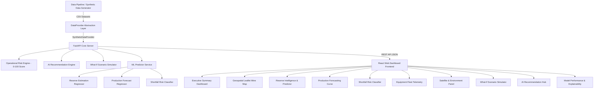

# MineAI Sentinel ⚡
### AI-Powered Manganese Reserve Intelligence & Production Risk Platform

> **Hackathon Prototype for MOIL Limited Problem Statement**  
> *Developed by CSE / Artificial Intelligence Engineering Team*

---

## 📌 Executive Summary & Problem Statement

**MOIL Limited** is the largest producer of Manganese Ore in India. To meet future demand, accurately identifying reserves and eliminating production shortfalls is critical. Present reserve estimation and production planning rely on manual surveys and drilling records, which can lead to mismatches between expected and actual ore production.

**MineAI Sentinel** is an enterprise-grade AI decision-support platform that unifies:
1. **Geological indicators** (Drill depth, rock density, borehole density, Mn grade %)
2. **Historical production records** (Daily target vs actual tonnage, active machinery)
3. **Equipment performance telemetry** (Breakdown downtime, maintenance frequency, fleet availability %)
4. **Satellite & Space inputs** (Precipitation, soil moisture ratio, vegetation NDVI, land surface temperature)
5. **Operational constraints** (Blasting clearance delays, weather disruptions, pit haulage bottlenecks)

---

## 🚨 MANDATORY DATA DISCLAIMER

> [!IMPORTANT]
> **Demo / Prototype Data Disclosure**:
> The developers do not possess confidential MOIL operational or geological datasets. All data presented in this platform is generated by a realistic, physically-correlated **Synthetic Data Generator** (`backend/ml/generator.py`) modeling Balaghat and Ukwa manganese ore formations. All UI views display a **"Demo Mode — Synthetic Dataset"** badge. The application uses a decoupled `DataProvider` abstraction layer allowing real MOIL database connections to replace synthetic demo data without altering frontend or ML logic.

---

## 🛠️ System Architecture



---

## ✨ Key Modules & Features

1. **Executive Dashboard**: Top KPI cards (Estimated Reserves, Recoverable Ore, Daily Tonnage Target vs Actual, Fleet Availability, Forecasted Gap, Shortfall Risk, Active System Alerts).
2. **Geospatial Mine Map**: Interactive Leaflet map displaying synthetic mine blocks around Balaghat & Ukwa sectors color-coded by risk level and production priority.
3. **Reserve Estimation**: ML-based reserve predictor calculating estimated tonnage, manganese grade %, recoverable reserve, and confidence score.
4. **Production Forecasting**: Time-series regressor with chronological lag features (`lag_1d`, `lag_7d`, `rolling_7d_mean`) predicting 1-day, 7-day, and 30-day output curves.
5. **Shortfall Risk Classifier**: Multi-class risk classifier (`LOW`, `MEDIUM`, `HIGH`) returning shortfall probability % and explainable AI feature importance breakdown.
6. **Equipment Health Telemetry**: Real-time fleet tracking of haul trucks, excavators, blast drills, and loaders with breakdown frequency and availability ratings.
7. **Satellite & Environmental Factors**: Telemetry monitoring rainfall depth, satellite soil moisture, NDVI vegetation cover, land surface temperature, and haul road stability.
8. **What-If Scenario Simulator**: Interactive parameter sliders (fleet availability, downtime, rainfall, shift hours, active machines) with live side-by-side BEFORE vs AFTER comparison.
9. **AI Recommendation Hub**: Actionable decision-support recommendations ranking corrective actions for mine planning and shortfall mitigation.
10. **Model Performance**: Transparent validation metrics (MAE, RMSE, R², Accuracy, Precision, Recall, F1, ROC-AUC) calculated dynamically on out-of-sample test splits.

---

## 🏆 2-3 Minute Judge Demonstration Flow

1. **Step 1: Executive Dashboard**  
   Open the application dashboard. Review top KPI cards, daily target vs actual production gap, and active risk alerts. Observe the **"Demo Mode — Synthetic Dataset"** badge.
2. **Step 2: Mine Reserve Map**  
   Navigate to **Mine Reserve Map**. Click on block **BLK-B01 (Balaghat Central Vein)**. Inspect estimated tonnage, Mn grade %, risk rating, and production priority.
3. **Step 3: Production Forecasting**  
   Navigate to **Production Forecast**. View historical production vs target vs predicted 7-day and 30-day forecast curves.
4. **Step 4: Shortfall Risk & Explainability**  
   Navigate to **Shortfall Risk**. Inspect the Shortfall Probability gauge (e.g. 74.5%) and explainable AI top contributing factors (Equipment Downtime 38.5%, Heavy Rainfall 26.2%).
5. **Step 5: AI Recommendation Action Hub**  
   Navigate to **AI Recommendations**. Review dynamic corrective actions (e.g. re-deploying haul trucks from low-priority blocks to high-yield veins).
6. **Step 6: What-If Simulator**  
   Navigate to **What-If Simulator**. Increase Equipment Availability slider from 70% to 90% and reduce Downtime from 4.5h to 1.0h. Execute simulation and observe live shortfall risk downgrade from HIGH to LOW.
7. **Step 7: Model Performance**  
   Navigate to **Model Performance**. Review actual out-of-sample test metrics (95.7% classifier accuracy, R² 0.967 on production forecasting).

---

## 🚀 Running Locally

### Prerequisites
- Python 3.10+ (Tested on Python 3.13)
- Node.js v18+ & npm

### 1. Backend Setup & Startup
```bash
cd mineai-sentinel/backend

# Create virtual environment (optional)
python -m venv venv
# On Windows: venv\Scripts\activate

# Install dependencies
pip install -r requirements.txt

# Generate synthetic datasets & train ML models
python ml/generator.py
python ml/train.py

# Start FastAPI backend server
python app/main.py
```
*Backend runs at `http://localhost:8000` (API documentation at `http://localhost:8000/docs`).*

### 2. Frontend Setup & Startup
```bash
cd mineai-sentinel/frontend

# Install packages
npm install

# Start Vite React development server
npm run dev
```
*Frontend runs at `http://localhost:5173`.*

---

## 🐳 Docker Execution

Launch the full-stack containerized application in one command:
```bash
cd mineai-sentinel
docker-compose up --build -d
```
- Dashboard UI: `http://localhost:5173`
- FastAPI REST API: `http://localhost:8000/api`

---

## 📊 Machine Learning Model Evaluation Summary

| Model Pipeline | Selected Algorithm | Primary Metric 1 | Primary Metric 2 | Primary Metric 3 |
| :--- | :--- | :--- | :--- | :--- |
| **Reserve Estimation** | `RandomForestRegressor` | MAE: 531.25 MT | RMSE: 578.90 MT | R²: 0.5416 |
| **Production Forecasting** | `GradientBoostingRegressor` (with Lags) | MAE: 54.45 tpd | RMSE: 71.30 tpd | R²: 0.9672 |
| **Shortfall Risk** | `HistGradientBoostingClassifier` | Accuracy: 95.74% | F1 Score: 0.9464 | ROC-AUC: 0.9894 |

*Metrics are calculated directly on out-of-sample test splits generated by `backend/ml/train.py`.*

---

## 👥 Engineering Team & Contributions

- **AI/ML & Data Engineering**: ML pipeline design, synthetic data generator, lag feature engineering, model training & joblib persistence.
- **Backend Architecture & APIs**: FastAPI REST endpoints, Pydantic v2 schemas, Operational Risk Engine, Recommendation Engine, What-If Simulator.
- **Frontend & Geospatial UX**: Modern React dashboard, Tailwind CSS glassmorphism UI, Leaflet mine map, Recharts telemetry visualizations.
- **DevOps & Integration**: Docker Compose configuration, pytest test suite, documentation, and cloud deployment setup.
