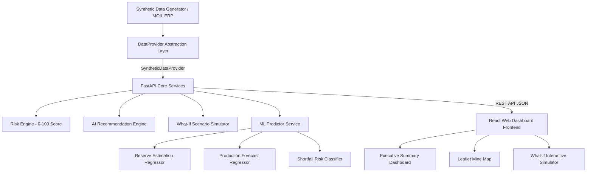

# System Architecture Specification — MineAI Sentinel

## 1. High-Level Architecture Overview

MineAI Sentinel follows a decoupled micro-architecture consisting of a high-performance Python FastAPI backend application server, an ML execution engine, a data provider abstraction layer, and a modern React Vite frontend dashboard.



## 2. Component Design

### 2.1 Backend (FastAPI + Pydantic v2)
- Entry point: `backend/app/main.py`
- Endpoints router: `backend/app/api/endpoints.py`
- Schemas: `backend/app/models/pydantic_schemas.py`
- Business domain services:
  - `RiskEngine`: Calculates composite 0-100 operational risk scores across equipment downtime, rainfall, blasting clearance, reserve availability, and target pressure ratio.
  - `RecommendationEngine`: Weighs risk factor contributions against transparent rule logic to output ranked corrective operational actions.
  - `SimulatorService`: Provides dynamic scenario simulation comparing BEFORE baseline vs AFTER parameter adjustments.
  - `AlertEngine`: Proactively evaluates ML predictions, risk scores, equipment telemetry, weather, and reserves to trigger deduplicated alerts answering:
    1. **WHAT happened?**
    2. **WHY is it happening?** (XAI feature importance & root cause telemetry)
    3. **HOW serious is it?** (Risk score 0-100 & shortfall probability %)
    4. **WHAT should the operator do?** (AI Recommendations & What-If action simulation)

### 2.2 Alert System Architecture & Lifecycle Flow

```
   DATA TELEMETRY
         │
   ML PREDICTORS & RISK ENGINE
         │
   ALERT ENGINE (Deduplication Fingerprinting)
         │
   ┌──────────────────────────────────────────────┐
   │ 🚨 ALERT CENTER (Active / History Views)     │
   │ 1. WHAT happened                             │
   │ 2. WHY (XAI feature importance breakdown)   │
   │ 3. HOW serious (Severity & Risk Score)       │
   │ 4. WHAT to do (AI Actions & Recommendations)  │
   └──────────────────────────────────────────────┘
         │
   WHAT-IF SIMULATOR INTEGRATION
         │
   RECALCULATED RISK DELTA
```

### 2.3 Data Provider Pattern (`DataProvider` Interface)
- Abstract Base Class: `DataProvider`
- Active Concrete Implementation: `SyntheticDataProvider` (reads synthetic CSVs from `data/raw/`).
- Extensible Class: `RealDataProvider` (connects directly to PostgreSQL / MOIL ERP SQL databases without touching frontend or ML code).

### 2.4 Frontend (React + Vite + Tailwind CSS)
- State Manager: `App.jsx`
- Custom dark glassmorphism design system.
- Components: `AlertCenter.jsx`, `AlertDetailModal.jsx`, `AlertConfigModal.jsx`, `AlertHistory.jsx`, `ExecutiveDashboard.jsx`, `WhatIfSimulator.jsx`.
- Map library: `Leaflet` & `React-Leaflet` for interactive mine block popups.
- Charting library: `Recharts` for time-series production trends, risk distributions, and equipment availability bar charts.

